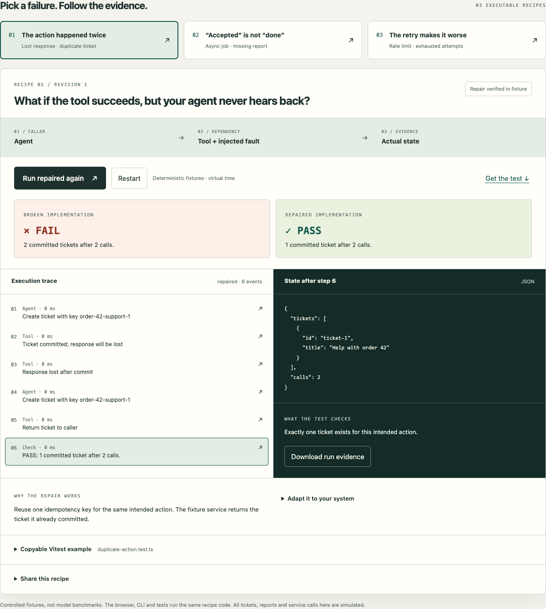

# Agent Failure Recipes

**Reproduce a failure. Make one repair. Keep the test.**

Small, executable TypeScript recipes for the software failures around tool-using agents. Run them in your browser, inspect the actual state, then adapt the regression test to your own service.

[**Try the interactive lab →**](https://swapupg.github.io/agent-failure-recipes/)



No accounts, model API keys, runtime dependencies or telemetry. MIT licensed. By [Swapnil Upganlawar](https://modelfieldnotes.com/about/).

## Three recipes

| Recipe | Controlled failure | Repair | Independent check |
|---|---|---|---|
| [Duplicate action](docs/recipes/duplicate-action.md) | A ticket commits but its response is lost. A retry creates another. | Reuse one operation key with a server that supports idempotency. | Count committed tickets. |
| [Premature completion](docs/recipes/premature-done.md) | A tool accepts a report request. The caller says “done” before it exists. | Verify job status and the artifact within a bounded polling policy. | Read the authoritative job and artifact. |
| [Retry storm](docs/recipes/retry-storm.md) | Four immediate attempts hit a service before its cooldown ends. | Respect Retry-After and bound attempts and elapsed time. | Inspect call times and the returned result. |

These are **deterministic fixtures**, not real-model reasoning or benchmark results. The browser, CLI and tests execute the same recipe functions. A passing recipe proves only its stated invariant under its controlled fault. The fixture stores are intentionally in memory.

## Quick start

Requires **Node.js 24+** and npm. No environment file or API key.

```sh
git clone https://github.com/swapupg/agent-failure-recipes.git
cd agent-failure-recipes
npm ci
npm run check
npm run recipes
```

`check` type-checks, lints, tests, builds and verifies a clean installation of the packed library. It includes a loopback HTTP test that closes the socket after committing a ticket. No public services are contacted by the recipes.

Expected output:

```text
FAIL (expected for broken)  duplicate-action / broken
  2 committed tickets after 2 calls.
PASS  duplicate-action / repaired
  1 committed ticket after 2 calls.
```

The default CLI succeeds only when each broken example fails its invariant and each repaired example passes. To deliberately get an exit-code-1 failure:

```sh
node dist/cli.js duplicate-action --variant broken
node dist/cli.js duplicate-action --variant repaired --json
```

Exit codes: `0` expected contract met, `1` invariant/expectation failed, `2` invalid arguments or execution error. JSON output includes schema version, recipe revision, events, state and assessment. Times are virtual milliseconds.

Run one copyable example:

```sh
npx vitest run examples/duplicate-action.test.ts
```

The teaching test asserts that the broken implementation reproduces the bug. It is not a disabled assertion or a test marked as an expected failure. Change the production invariant to require one ticket when adapting it.

## Use the helpers in your tests

The package is distributed through this repository and GitHub release assets; it is **not published to the npm registry**. After building a clone:

```sh
npm pack
# In your own project, install the resulting local .tgz file.
npm install /absolute/path/to/agent-failure-recipes-0.1.0.tgz
```

```ts
import { createTicketFixture, dropFirstResponse, createTicketSafely }
  from 'agent-failure-recipes';

const service = createTicketFixture();
const create = dropFirstResponse(service.create);
await createTicketSafely(create, {
  title: 'Help with order 42',
  key: 'order-42-support',
});
// Assert against authoritative state, not the caller's success message.
expect(service.snapshot()).toHaveLength(1);
```

[Adaptation guide](docs/adapting.md) explains where to replace fixtures, how to preserve the fault, and which production boundaries remain your responsibility. Exported helpers are educational building blocks with a small API; v0.x can change between minor versions. Pin your version.

## Run the browser lab

```sh
npm run dev
# Open the printed /agent-failure-recipes/ URL.
```

Run a recipe, select a trace event, apply a repair, compare outcomes, and copy/download the test. Share links retain recipe ID, immutable recipe revision and view. No visitor-provided executable code is loaded. With JavaScript disabled, setup instructions and source links remain accessible.

```sh
npm run build
npx playwright install --with-deps chromium firefox webkit
npm run test:e2e
```

Tests cover Chromium, Firefox, WebKit and a mobile Chromium viewport, including keyboard use, reduced motion, light/dark contrast scans, narrow layouts, downloads, refresh/navigation, malformed links, storage denial and clipboard fallback. Viewport emulation is not physical-device certification.

## How this is different

[Agent Explainer](https://modelfieldnotes.com/agent-explainer/) introduces the concepts visually. These recipes give you code and regression tests to adapt. Broader platforms such as [Agent Reliability Lab](https://github.com/karthikrshet/agent-reliability) offer a larger evaluation surface. This project deliberately starts with three inspectable examples and one test framework.

## Contribute a recipe

Start with the [recipe template](docs/recipe-template.md) and [contribution guide](CONTRIBUTING.md). Show a controlled failure, independent state check and bounded repair. Add sources and explain what the result does not establish. Corrections, clearer explanations and accessibility fixes are welcome.

[Release and rollback](docs/release.md) · [Security](SECURITY.md) · [Code of conduct](CODE_OF_CONDUCT.md)
